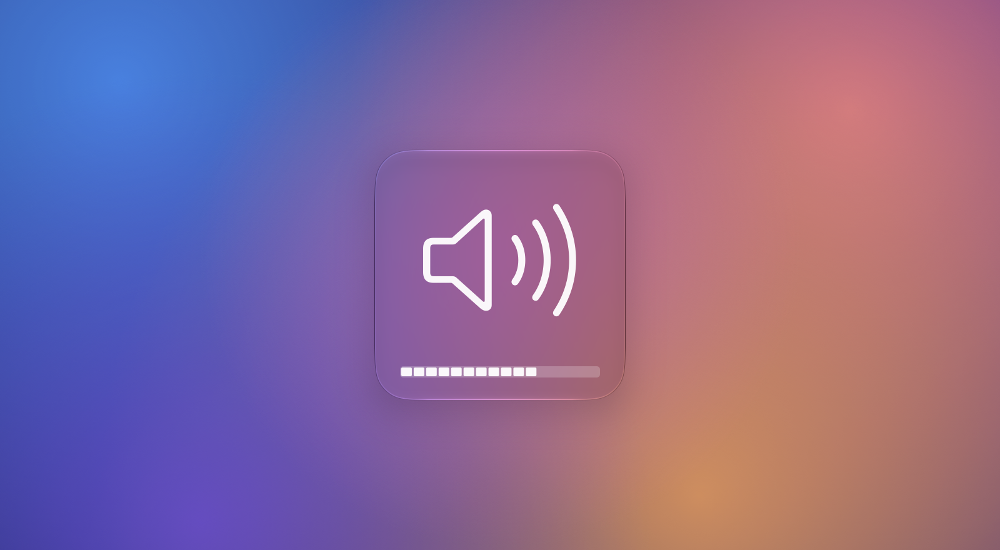
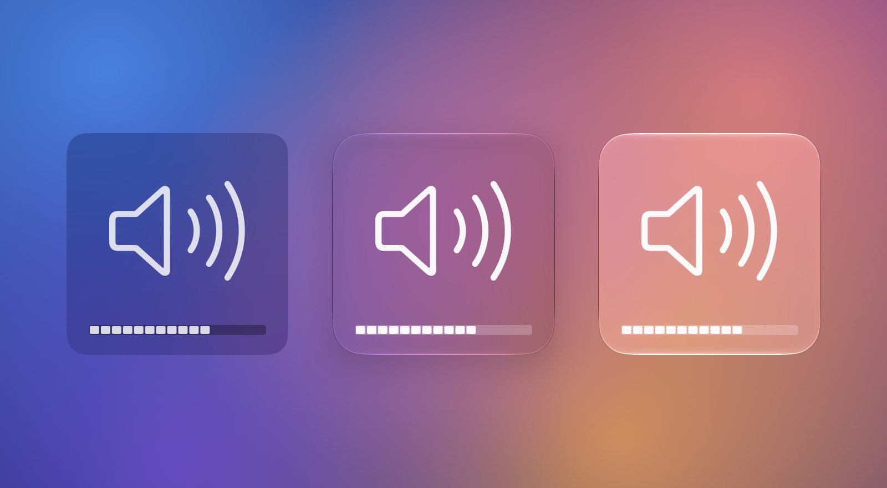

<p align="center">
  
</p>

# ReBezel

The big centered volume and brightness bezel is back on macOS 26, redrawn in Liquid Glass.

macOS Tahoe moved the volume and brightness indicator into a small banner in the top-right
corner of the screen. ReBezel puts it back where your eyes already go: a square in the middle
of the screen with a large glyph and the 16-segment level bar Mac users know, now made of the
same glass as the rest of macOS 26.

**[Download ReBezel](https://github.com/Elhoej/ReBezel/releases/latest)** (requires macOS 26 or later)

## Pick your glass

<p align="center">
  
</p>

From left to right: Classic, Liquid Glass (Regular) and Liquid Glass (Clear). Regular is
frosted and follows the Liquid Glass tint you choose in System Settings. Clear is the
transparent, lensed glass Control Center uses for its own modules. Classic is the dark bezel
from macOS 11 to 15, for anyone who misses it exactly as it was.

The bezel sits near the bottom of the screen by default, and you can move it to the center or
the top. It appears on the screen your pointer is on, or on every screen at once if you prefer.

## Your keys work the way they always did

Volume up, volume down, mute and the brightness keys behave as before. The only difference is
the bezel you see.

The old shortcuts are back too. Hold Shift+Option while pressing a volume or brightness key to
move in quarter steps, and the bezel fills each segment a quarter at a time. Hold Option to
jump straight to the Sound or Displays settings.

With an Apple Studio Display, Pro Display XDR or LG UltraFine connected, hold Control and press
a brightness key to change that display's brightness. The bezel shows up on that display.
Third-party monitors controlled over DDC aren't supported, and the keyboard backlight keys are
left to macOS.

## It stays out of your way

ReBezel lives in the menu bar and has no Dock icon. It can start at login, and you can hide
the menu bar icon entirely. To get the icon back, open ReBezel again from Finder, Spotlight or
Launchpad.

It checks for updates once a day, shows you the release notes, and installs only when you say
so. The app is signed with a Developer ID and
notarized by Apple, so macOS opens it without a Gatekeeper warning.

## Getting started

1. [Download the DMG](https://github.com/Elhoej/ReBezel/releases/latest) and drag ReBezel into
   Applications.
2. Open it. A short walkthrough lets you try each style and position with a live preview.
3. Grant Accessibility access when asked. As soon as macOS allows it, a bezel says "Voilá!"
   and you're done.

ReBezel needs Accessibility access because Control Center draws the Tahoe banner itself and
there's no setting to turn it off. ReBezel catches the volume and brightness keys before
Control Center sees them, changes the volume or brightness itself, and shows its own bezel.
Until the permission is granted, the menu bar icon shows a warning triangle.

All settings are in Preferences (⌘, from the menu bar icon).

## Troubleshooting

If you used a build older than 1.1.0, install 1.1.0 or later by hand from the DMG and grant
Accessibility access again. Updates after that arrive inside the app and keep the permission.

If ReBezel's entry in the Accessibility list gets stuck, reset it and grant access again:

```sh
tccutil reset Accessibility com.simonelhoej.ReBezel
```

## Building from source

Build instructions, how the key interception works, and the release process are in
[docs/DEVELOPMENT.md](docs/DEVELOPMENT.md).
